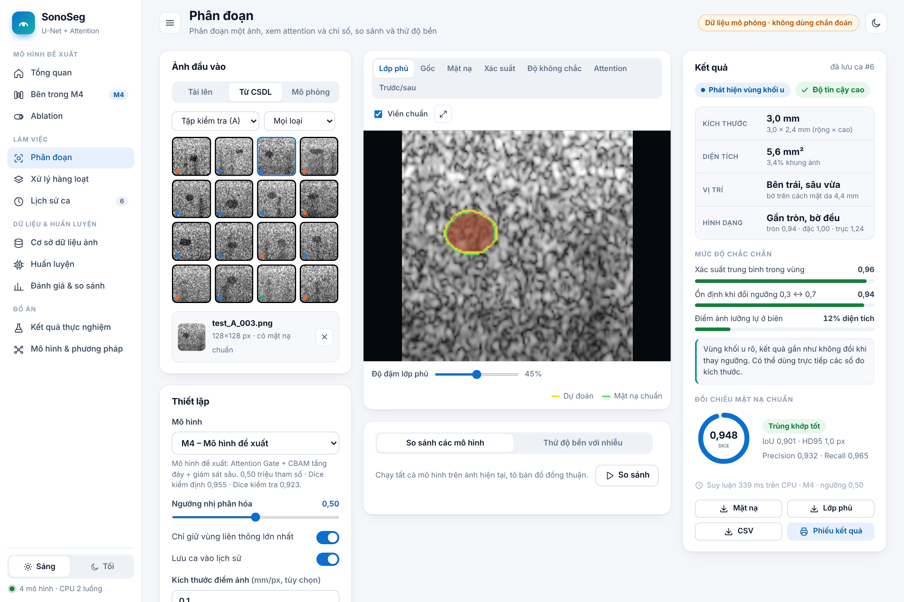
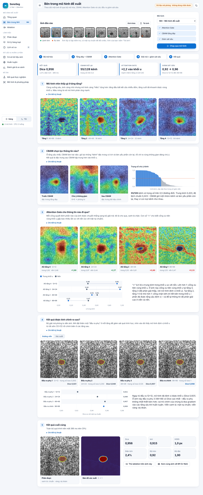
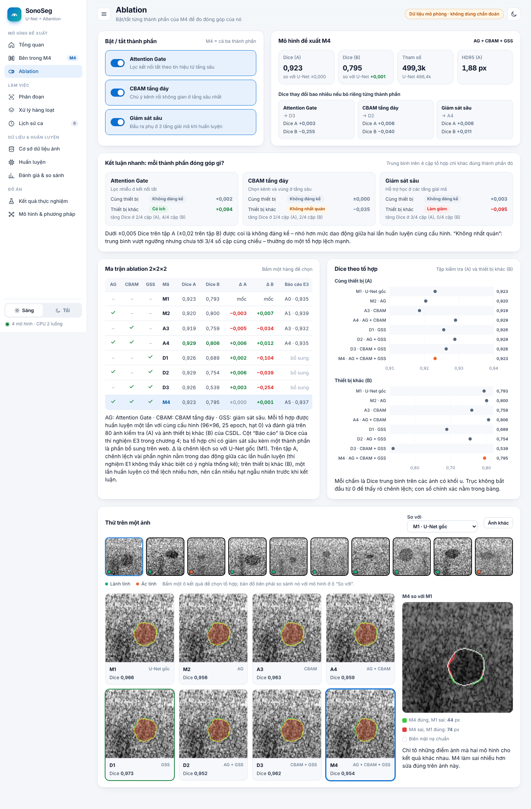
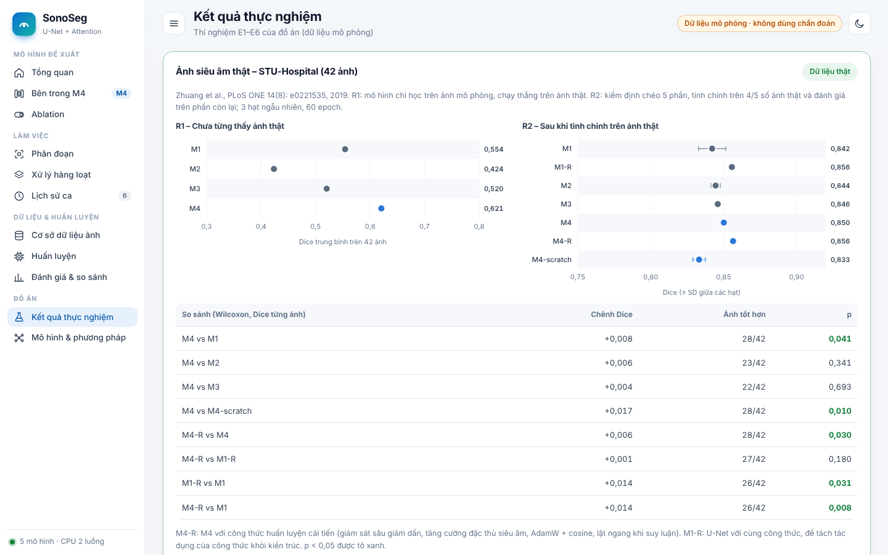

# Phân đoạn ảnh y tế (Medical Image Segmentation) hỗ trợ chẩn đoán: ảnh siêu âm vú sử dụng mô hình U-Net kết hợp Attention Mechanism

Mã nguồn, phần mềm **SonoSeg** và tài liệu của đồ án tốt nghiệp thạc sĩ CNTT (khóa CH13, Trường Đại học Điện lực).

- Học viên: Đào Nguyên Trung (25CH0000018)
- Người hướng dẫn: TS. Nguyễn Văn Đoàn

> ⚠️ Đây là công cụ nghiên cứu và minh họa, **không** phải thiết bị y tế. Kết quả không thay thế chẩn đoán của bác sĩ.



## Nội dung chính

- **Mô hình đề xuất M4:** U-Net kết hợp ba thành phần:
  - **Attention Gate** trên 4 kết nối tắt;
  - **CBAM** (chú ý kênh và không gian) ở tầng đáy;
  - **giám sát sâu** bằng 3 đầu ra phụ.

  M4 được so sánh với U-Net (M1), Attention U-Net (M2) và U-Net + CBAM (M3), kèm ma trận ablation 2×2×2.
- **Thực nghiệm trên hai loại dữ liệu:**
  - ảnh siêu âm **mô phỏng** (thí nghiệm E1–E6, 880 ảnh);
  - ảnh siêu âm **thật** STU-Hospital (thí nghiệm R1–R2, 42 ảnh, mặt nạ do bác sĩ vẽ);
  - ảnh siêu âm **thật** BUSI (thí nghiệm R3, 682 ảnh sau khi lọc trùng);
  - **gộp 3 bộ ảnh thật** BUSI + BUS-BRA + BrEaST (thí nghiệm R4, 2.767 ảnh, chia theo bệnh nhân) – cải thiện dữ liệu đầu vào.
- **Phần mềm web SonoSeg:** Flask + PyTorch, chạy trên CPU, không cần GPU. Gồm các trang:
  - phân đoạn, có kích thước, vị trí, độ tin cậy và phiếu kết quả PDF;
  - "Bên trong M4": xem từng bước CBAM, Attention Gate và giám sát sâu;
  - ablation tương tác;
  - huấn luyện ngay trên web;
  - đánh giá và so sánh mô hình;
  - xử lý hàng loạt;
  - lịch sử ca, lưu trong cơ sở dữ liệu SQLite;
  - **Đối chiếu nghiên cứu**: bối cảnh y học Việt Nam, so sánh với công trình đã công bố, danh mục bộ dữ liệu (tiến độ hướng tới 10.000 ảnh), đề tài trên GitHub, nền tảng chạy offline.

## Kết quả trên ảnh siêu âm thật (STU-Hospital, 42 ảnh)

**R1 – Chưa từng thấy ảnh thật.** Mô hình chỉ học trên ảnh mô phỏng, chạy thẳng trên 42 ảnh thật:

| | M1 U-Net | M2 Attention U-Net | M3 U-Net + CBAM | **M4 đề xuất** |
|---|---|---|---|---|
| Dice | 0,554 | 0,424 | 0,520 | **0,621** |

**R2 – Tinh chỉnh trên ảnh thật.** Kiểm định chéo 5 phần, 3 hạt ngẫu nhiên, 60 epoch, ảnh 96×96. Dice tính trên phần giữ lại:

| Cấu hình | Dice TB | SD giữa các hạt | Số ảnh Dice ≥ 0,80 |
|---|---|---|---|
| M1 U-Net | 0,842 | 0,009 | 36/42 |
| M2 Attention U-Net | 0,844 | 0,003 | 36/42 |
| M3 U-Net + CBAM | 0,846 | 0,000 | 34/42 |
| **M4 đề xuất** | **0,850** | 0,002 | **37/42** |
| M4 khởi tạo ngẫu nhiên (không tiền huấn luyện trên ảnh mô phỏng) | 0,833 | 0,004 | 33/42 |
| M1 + công thức cải tiến R | 0,856 | 0,001 | 36/42 |
| **M4 + công thức cải tiến R (M4-R)** | **0,856** | 0,001 | 36/42 |

Kiểm định Wilcoxon theo cặp trên Dice từng ảnh:

| So sánh | Δ Dice | p |
|---|---|---|
| M4 so với M1 | +0,008 | 0,041 |
| M4 so với M4 khởi tạo ngẫu nhiên | +0,017 | 0,010 |
| M4-R so với M4 | +0,006 | 0,030 |
| M4-R so với M1-R | +0,001 | 0,18 (không đáng kể) |

Diễn giải trung thực:
- **M4 khái quát tốt nhất** khi gặp ảnh thật chưa từng thấy.
- Sau khi tinh chỉnh, M4 nhỉnh hơn U-Net một chút.
- **Tiền huấn luyện trên ảnh mô phỏng có ích rõ.**
- Công thức cải tiến R giúp **cả M1 lẫn M4** ngang nhau, tức phần lợi nằm ở cách huấn luyện, không ở kiến trúc.
- Có 8 phép so sánh trên cùng 42 ảnh. Nếu hiệu chỉnh Bonferroni (ngưỡng 0,006), chưa phép nào đạt ý nghĩa thống kê. Vì vậy đồ án kiểm chứng tiếp trên BUSI (R3, bên dưới).

Công thức cải tiến **R** gồm:
- giám sát sâu với trọng số giảm dần về 0;
- tăng cường dữ liệu đặc thù siêu âm: nhiễu đốm nhân, làm mờ, gamma;
- AdamW + lịch tốc độ học cosine;
- lật ngang khi suy luận.

Trọng số **M4-STU** (M4-R huấn luyện trên cả 42 ảnh) có sẵn trong `weights/real/` và chọn được trên web.

Chạy lại các thí nghiệm này: `python manage.py import-stu`, sau đó `python real_experiments.py`. Mất khoảng 55 phút trên CPU 2 nhân.

## Kết quả trên BUSI (R3, 682 ảnh)

BUSI (Al-Dhabyani et al., *Data in Brief* 28, 2020) gồm ảnh lành tính, ác tính và bình thường. Sau khi lọc ảnh trùng bằng average-hash còn 682 ảnh, chia phân tầng 476 / 68 / 138 (huấn luyện / kiểm định / kiểm tra, hạt 0). Mọi mô hình khởi tạo từ trọng số mô phỏng, huấn luyện 50 epoch ở 96×96, chọn epoch theo Dice kiểm định. Cùng mô hình đó được chạy thẳng trên 42 ảnh STU (ngoài miền, chưa học).

| Cấu hình | Dice BUSI | HD95 (px) | Báo sai trên ảnh bình thường | Dice STU (ngoài miền) |
|---|---|---|---|---|
| M1 U-Net | 0,777 | 9,7 | 91% | 0,836 |
| M2 Attention U-Net | 0,786 | 8,5 | 100% | 0,826 |
| M3 U-Net + CBAM | 0,771 | 9,7 | 100% | 0,832 |
| M4 đề xuất | 0,773 | 9,1 | 50% | 0,797 |
| M1 + công thức R | 0,784 | 8,4 | 86% | 0,844 |
| **M4 + công thức R** | **0,788** | 8,9 | 82% | **0,846** |

- M4-R cao hơn U-Net trên BUSI: Δ = +0,011, Wilcoxon p = 0,018 (70/116 ảnh có khối u tốt hơn).
- M4 không có công thức R thấp hơn U-Net một chút (Δ = −0,005, p = 0,037). Lợi ích chủ yếu đến từ cách huấn luyện; M4-R so với M1-R chỉ nhỉnh +0,005 (p = 0,089).
- Tỷ lệ báo sai trên ảnh bình thường cao.

**Trọng số M4-BUSI trên web.** Huấn luyện lại M4-R trên 476 ảnh, 70 epoch, ở 128×128. Bản này được chọn thay bản 96×96 vì Dice trên tập kiểm định cao hơn (0,780 so với 0,758). Bộ lọc hậu xử lý cũng được chọn trên tập kiểm định: ngưỡng 0,6, bỏ vùng có xác suất đỉnh dưới 0,95.

| M4-BUSI trên 138 ảnh kiểm tra | Không lọc | Có lọc (mặc định trên web) |
|---|---|---|
| Dice trên ảnh có khối u | 0,787 | 0,786 |
| Báo sai trên 22 ảnh bình thường | 100% | 73% |
| Số ảnh có khối u bị bỏ sót | 4/116 | 6/116 |
| Dice STU (ngoài miền) | 0,856 | 0,842 |

Bộ lọc là một sự đánh đổi: ít báo nhầm hơn nhưng bỏ sót nhiều hơn một chút. Báo nhầm trên ảnh bình thường vẫn là điểm yếu chính, vì ảnh bình thường chỉ chiếm khoảng 1/6 bộ BUSI. Trên web có thể tắt bộ lọc bằng công tắc "Chỉ giữ vùng liên thông lớn nhất" ở trang Phân đoạn.

Chạy lại: giải nén BUSI vào `data/external/Dataset_BUSI_with_GT`, rồi `python manage.py import-busi` và `python busi_experiments.py`. Mất khoảng 32 phút trên CPU 2 nhân. Lưu trọng số web: `BUSI_SIZE=128 python busi_experiments.py --final M4-R --epochs 70`, sau đó `BUSI_SIZE=128 python busi_experiments.py --tune weights/real/M4-BUSI-128.pt` và đổi tên thành `M4-BUSI.pt`.

## R4 – Gộp 3 bộ ảnh thật (cải thiện dữ liệu đầu vào)

BUSI (Ai Cập, giữ đúng cách chia R3) + BUS-BRA (Brazil, 1.834 ảnh / 1.060 bệnh nhân, **chia theo bệnh nhân**) + BrEaST (Ba Lan, 251 ảnh). Loại 42 ảnh gần trùng bằng dHash. Huấn luyện 1.939 ảnh, kiểm định 276, kiểm tra 552 (530 ảnh có khối u). STU (42 ảnh) không bao giờ được học. Mọi mô hình dùng công thức R, 96×96, 40 epoch, một hạt.

| Cấu hình | BUSI | BUS-BRA | BrEaST | Gộp 3 bộ | STU (chưa học) |
|---|---|---|---|---|---|
| M1-R U-Net | 0,779 | 0,860 | 0,795 | 0,836 | 0,885 |
| M2-R Attention U-Net | 0,772 | 0,861 | 0,790 | 0,835 | 0,876 |
| M3-R U-Net + CBAM | 0,795 | 0,865 | 0,791 | 0,843 | 0,886 |
| **M4-R đề xuất** | 0,784 | **0,866** | 0,791 | 0,841 | 0,885 |
| M4-R chỉ học BUSI (R3) | 0,783 | 0,702 | 0,672 | 0,717 | 0,846 |

- **Dữ liệu quan trọng hơn kiến trúc.** Cùng M4-R, học 3 bộ thay vì chỉ BUSI: Dice gộp 0,717 → 0,841 (Δ = +0,124, Wilcoxon p < 0,001, 418/530 ảnh tốt hơn); STU 0,846 → 0,885 (Δ = +0,039, p < 0,001, 31/42 ảnh).
- Khi đủ dữ liệu, M4-R hơn U-Net (Δ = +0,005, p < 0,001, 296/530 ảnh) và Attention U-Net (Δ = +0,006, p = 0,011) trên tập gộp; ngang U-Net + CBAM (Δ = −0,002, p = 0,56). Chênh lệch nhỏ, một hạt.

Trọng số web **M4-MIX** là một lượt huấn luyện lại cùng cấu hình (trên CPU kết quả không lặp lại tuyệt đối): BUSI 0,775 · BUS-BRA 0,855 · BrEaST 0,792 · gộp 0,832 · STU 0,886.

Chạy lại: `python fetch_data.py` (hoặc `--mirror`), giải nén BUSI vào `data/external/Dataset_BUSI_with_GT`, rồi `python mix_experiments.py --epochs 40` (khoảng 70 phút trên CPU 2 nhân) và `python mix_experiments.py --final M4-R` để lưu `weights/real/M4-MIX.pt`.

## Đối chiếu với công trình đã công bố

| Công trình | Dữ liệu | Dice |
|---|---|---|
| AAU-net (Chen et al., IEEE TMI 2023) | BUSI, kiểm định chéo 4 phần | U-Net 0,701 · Attention U-Net 0,680 · AAU-net 0,775 |
| AAU-net | Học Dataset B, kiểm tra STU | U-Net 0,714 · AAU-net 0,802 |
| BUS-Set (Thomas et al., Med. Phys. 2023) | 4 bộ gộp, 1.154 ảnh | Tốt nhất 0,851 |
| **Đồ án, M4-R** (0,5 triệu tham số, CPU) | BUSI / STU | 0,784 / 0,885 |

Giao thức khác nhau (đồ án lọc ảnh trùng, không tính ảnh bình thường vào Dice), nên chỉ so được về độ lớn. Chi tiết, nguồn và danh sách đề tài tương tự trên GitHub: trang **Đối chiếu nghiên cứu** trên web hoặc `results/related.json`.

## Chạy nhanh

```bash
git clone https://github.com/trungnguyen107/medical-image-segmentation-breast-ultrasound-unet-attention.git
cd medical-image-segmentation-breast-ultrasound-unet-attention
pip install -r requirements.txt
python app.py --open                 # http://127.0.0.1:5000
```

Trên Windows, chỉ cần bấm đúp `run_web.bat`; cần Python 3.10 trở lên.

Lần chạy đầu, ứng dụng tự làm hai việc, **không cần Internet**:
- tạo cơ sở dữ liệu `data/app.db` và bộ ảnh mô phỏng mẫu;
- đánh giá các mô hình có sẵn.

**Chế độ offline.** Máy chủ chỉ lắng nghe `127.0.0.1`, giao diện không tải font, thư viện hay biểu đồ từ Internet. Ảnh siêu âm thật được đưa vào máy một lần bằng lệnh nhập (bên dưới); sau đó mọi thứ chạy ngoại tuyến. Việc tự tải STU-Hospital khi khởi động chỉ bật khi đặt `SONOSEG_FETCH_STU=1`.

## Dữ liệu ảnh siêu âm thật (bình thường / lành tính / ác tính)

Mục tiêu của đề tài là **10.000 ảnh thật có mặt nạ** (không tính ảnh mô phỏng và không tính ảnh nhân bản bằng tăng cường dữ liệu). Phần mềm chỉ *đếm và quản lý*, không tạo ảnh cho đủ số. Hiện đã dùng 2.809 ảnh (BUSI, BUS-BRA, BrEaST, STU); các bộ công khai có mặt nạ cộng lại khoảng 6.300 ảnh, và bộ gộp BUS-Large (KTH, 2026) có hơn 21.000 ảnh nhưng cần xin quyền truy cập (xem [DATASETS.md](DATASETS.md)); phần còn lại phải đến từ hợp tác bệnh viện (phê duyệt đạo đức, ẩn danh, bác sĩ vẽ mặt nạ).

```bash
python manage.py import-real busi   <thư mục BUSI>                      # benign/ malignant/ normal/, mặt nạ *_mask.png
python manage.py import-real busbra <thư mục BUS-BRA> --manifest bus_data.csv
python manage.py import-real uclm   <thư mục BUS-UCLM> --manifest <csv>
python manage.py import-real udiat  <thư mục Dataset B> --holdout       # tập kiểm tra ngoài, không bao giờ huấn luyện
python manage.py progress                                               # số ảnh thật so với 10.000
python manage.py dedup                                                  # cặp ảnh gần trùng giữa các bộ
```

Bộ nhập tự làm các việc sau:
- **loại ảnh trùng** bằng băm cảm nhận dHash, kể cả giữa các bộ khác nhau (BUSI có khoảng 19% ảnh trùng);
- **chia tập theo bệnh nhân** khi có cột mã bệnh nhân, phân tầng theo loại, để ảnh của một người không nằm ở cả huấn luyện lẫn kiểm tra;
- ảnh *bình thường* có mặt nạ rỗng; ảnh lành/ác thiếu mặt nạ bị bỏ qua (trừ khi dùng `--allow-no-mask`);
- ghi giấy phép và nguồn trích dẫn của từng bộ, hiển thị ở trang **Cơ sở dữ liệu ảnh** cùng thanh tiến độ.

Bảng kê CSV nhận các cột (không phân biệt hoa/thường): ảnh (`image`/`file`/`id`), mặt nạ (`mask`), nhãn (`label`/`pathology`/`class`), bệnh nhân (`patient`/`case`). Cách đặt tên cột và thư mục của từng bộ **chưa được kiểm tra với bản tải thật** trong môi trường phát triển (không có Internet); nếu lệnh nhập báo "thiếu mặt nạ/nhãn" hàng loạt, hãy tạo bảng kê riêng theo các cột trên.

### Cách nhanh để có ~2.000 ảnh thật và huấn luyện (máy có Internet)

```bash
python fetch_data.py                                   # tải BUS-BRA (1.875 ảnh, CC BY 4.0) từ Zenodo và nhập
python manage.py import-real uclm <thư mục BUS-UCLM> --manifest <csv>   # thêm ảnh BÌNH THƯỜNG (tải tay từ Mendeley)
python manage.py train-real --models M1,M4 --epochs 30 --size 128 --base 16
python manage.py sources                               # SOURCES.md + data/sources.csv: nguồn của từng ảnh
```
Trên Windows: bấm đúp `train_real.bat`. BUS-BRA chỉ có ảnh lành tính và ác tính, nên muốn đủ 3 trạng thái cần thêm ảnh bình thường từ BUS-UCLM hoặc BUSI. `train-real` huấn luyện U-Net (M1) và U-Net + Attention (M4) trên cùng dữ liệu, cùng tập chia, rồi in Dice/IoU, ΔDice và kiểm định Wilcoxon trên tập kiểm tra thật. Đường dẫn tệp Zenodo trong `fetch_data.py` và cấu trúc thư mục BUS-BRA chưa được kiểm tra với bản tải thật.

Trên web: tab **Phân đoạn → Ảnh thật** lấy ngẫu nhiên ảnh thật theo loại; trang **Huấn luyện** có mục *Nguồn dữ liệu huấn luyện* để chọn ảnh thật.

```bash
python manage.py import-stu                # 42 ảnh siêu âm thật (STU-Hospital)
python manage.py import-busi [thư mục]     # BUSI (benign/, malignant/, normal/) nếu đã tải về
python fetch_data.py                       # tải BUS-BRA (Zenodo) rồi nhập BUS-BRA, BrEaST đặt trong data/external
python fetch_data.py --mirror              # khi không vào được Zenodo: lấy từ bản sao trên GitHub
python -m pytest -q tests                  # kiểm thử API, chỉ số, bộ nhập ảnh thật
```

## Cấu trúc repo

| Đường dẫn | Nội dung |
|---|---|
| `models.py` | U-Net linh hoạt: M1–M4, các biến thể ablation; hàm `trace` ghi lại các bước trung gian |
| `train.py`, `run_experiments.py`, `evaluate_all.py` | Thí nghiệm E1–E6 trên ảnh mô phỏng |
| `real_experiments.py` | Thí nghiệm R1–R2 trên ảnh thật STU-Hospital |
| `busi_experiments.py` | Thí nghiệm R3 trên BUSI; `--final` lưu M4-BUSI, `--tune` chọn hậu xử lý |
| `mix_experiments.py` | Thí nghiệm R4 gộp 3 bộ ảnh thật; `--final M4-R` lưu M4-MIX; `--split-map` ghi cách chia cho CSDL web |
| `fetch_data.py` | Tải và nhập BUS-BRA, BrEaST (chia đúng như R4) |
| `data.py` | Bộ sinh ảnh siêu âm mô phỏng, tiền xử lý, tăng cường |
| `metrics.py` | Dice, IoU, Precision, Recall, HD95, chỉ số hình thái |
| `app.py`, `templates/`, `static/` | Máy chủ Flask và giao diện một trang (biểu đồ SVG tự viết) |
| `db.py`, `dataset_tools.py`, `manage.py`, `trainer.py` | CSDL SQLite, nhập dữ liệu, huấn luyện nền |
| `real_data.py` | Nhập ảnh siêu âm thật: loại trùng, chia theo bệnh nhân, giấy phép, theo dõi tiến độ 10.000 ảnh |
| `weights/final/` | M1–M4 (huấn luyện trên ảnh mô phỏng) |
| `weights/ablation/` | 5 biến thể ablation (A3, A4, D1–D3) |
| `weights/real/` | M4-MIX (3 bộ ảnh thật, khuyến nghị), M4-BUSI, M4-STU |
| `data/sample/` | 420 ảnh mô phỏng kèm mặt nạ |
| `results/` | Kết quả (`results.json`, `real_results.json`, `busi_results.json`, `mix_results.json`, `related.json`), hình, ảnh chụp giao diện |
| `docs/` | Báo cáo, slide, đề cương |
| [`DATASETS.md`](DATASETS.md) | Danh sách nguồn ảnh siêu âm vú thật (quốc tế và Việt Nam) |

## Dữ liệu

Repo **không** chứa ảnh thật. Lệnh `import-stu` tải ảnh STU-Hospital từ [github.com/xbhlk/STU-Hospital](https://github.com/xbhlk/STU-Hospital) (Zhuang et al., *PLoS ONE* 14(8): e0221535, 2019). Các bộ khác (BUSI, BUS-BRA, BrEaST, HiSBreast của Việt Nam, …) được liệt kê trong [DATASETS.md](DATASETS.md). Hãy tuân thủ giấy phép của từng bộ.

## Ảnh giao diện

| Bên trong M4 | Ablation | Ảnh thật |
|---|---|---|
|  |  |  |
