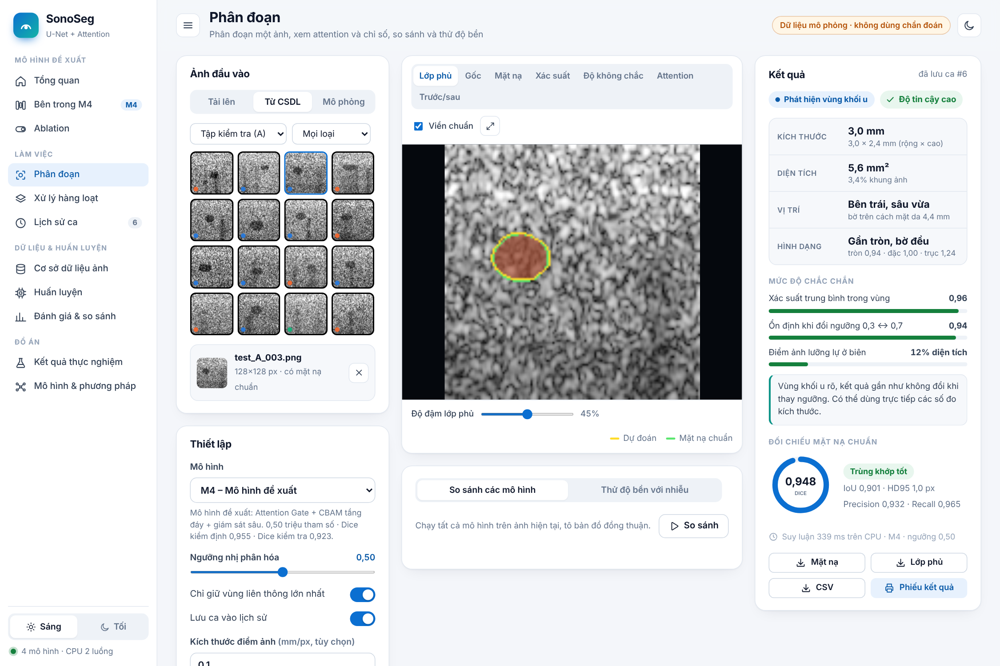
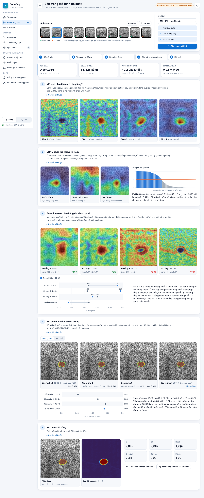
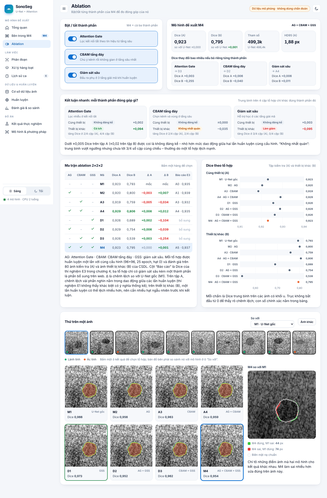
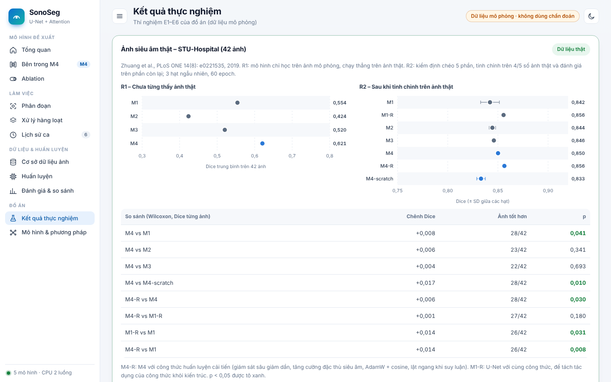

# Phân đoạn ảnh y tế (Medical Image Segmentation) hỗ trợ chẩn đoán: ảnh siêu âm vú sử dụng mô hình U-Net kết hợp Attention Mechanism

Mã nguồn, phần mềm **SonoSeg** và tài liệu của đồ án tốt nghiệp thạc sĩ CNTT (khóa CH13, Trường Đại học Điện lực).

- Học viên: Đào Nguyên Trung (25CH0000018)
- Người hướng dẫn: TS. Nguyễn Văn Đoàn

> ⚠️ Đây là công cụ nghiên cứu và minh họa, **không** phải thiết bị y tế. Kết quả không thay thế chẩn đoán của bác sĩ.



## Nội dung chính

- **Mô hình đề xuất M4:** U-Net kết hợp ba thành phần:
  - **Attention Gate** trên 4 kết nối tắt;
  - **CBAM** (chú ý kênh và không gian) ở tầng đáy;
  - **giám sát sâu** bằng 3 đầu ra phụ.

  M4 được so sánh với U-Net (M1), Attention U-Net (M2) và U-Net + CBAM (M3), kèm ma trận ablation 2×2×2.
- **Thực nghiệm trên hai loại dữ liệu:**
  - ảnh siêu âm **mô phỏng** (thí nghiệm E1–E6, 880 ảnh);
  - ảnh siêu âm **thật** STU-Hospital (thí nghiệm R1–R2, 42 ảnh, mặt nạ do bác sĩ vẽ).
- **Phần mềm web SonoSeg:** Flask + PyTorch, chạy trên CPU, không cần GPU. Gồm các trang:
  - phân đoạn, có kích thước, vị trí, độ tin cậy và phiếu kết quả PDF;
  - "Bên trong M4": xem từng bước CBAM, Attention Gate và giám sát sâu;
  - ablation tương tác;
  - huấn luyện ngay trên web;
  - đánh giá và so sánh mô hình;
  - xử lý hàng loạt;
  - lịch sử ca, lưu trong cơ sở dữ liệu SQLite.

## Kết quả trên ảnh siêu âm thật (STU-Hospital, 42 ảnh)

**R1 – Chưa từng thấy ảnh thật.** Mô hình chỉ học trên ảnh mô phỏng, chạy thẳng trên 42 ảnh thật:

| | M1 U-Net | M2 Attention U-Net | M3 U-Net + CBAM | **M4 đề xuất** |
|---|---|---|---|---|
| Dice | 0,554 | 0,424 | 0,520 | **0,621** |

**R2 – Tinh chỉnh trên ảnh thật.** Kiểm định chéo 5 phần, 3 hạt ngẫu nhiên, 60 epoch, ảnh 96×96. Dice tính trên phần giữ lại:

| Cấu hình | Dice TB | SD giữa các hạt | Số ảnh Dice ≥ 0,80 |
|---|---|---|---|
| M1 U-Net | 0,842 | 0,009 | 36/42 |
| M2 Attention U-Net | 0,844 | 0,003 | 36/42 |
| M3 U-Net + CBAM | 0,846 | 0,000 | 34/42 |
| **M4 đề xuất** | **0,850** | 0,002 | **37/42** |
| M4 khởi tạo ngẫu nhiên (không tiền huấn luyện trên ảnh mô phỏng) | 0,833 | 0,004 | 33/42 |
| M1 + công thức cải tiến R | 0,856 | 0,001 | 36/42 |
| **M4 + công thức cải tiến R (M4-R)** | **0,856** | 0,001 | 36/42 |

Kiểm định Wilcoxon theo cặp trên Dice từng ảnh:

| So sánh | Δ Dice | p |
|---|---|---|
| M4 so với M1 | +0,008 | 0,041 |
| M4 so với M4 khởi tạo ngẫu nhiên | +0,017 | 0,010 |
| M4-R so với M4 | +0,006 | 0,030 |
| M4-R so với M1-R | +0,001 | 0,18 (không đáng kể) |

Diễn giải trung thực:
- **M4 khái quát tốt nhất** khi gặp ảnh thật chưa từng thấy.
- Sau khi tinh chỉnh, M4 nhỉnh hơn U-Net một chút.
- **Tiền huấn luyện trên ảnh mô phỏng có ích rõ.**
- Công thức cải tiến R giúp **cả M1 lẫn M4** ngang nhau, tức phần lợi nằm ở cách huấn luyện, không ở kiến trúc.
- Có 8 phép so sánh trên cùng 42 ảnh. Nếu hiệu chỉnh Bonferroni (ngưỡng 0,006), chưa phép nào đạt ý nghĩa thống kê. Cần thêm dữ liệu thật (BUSI, BUS-BRA, …) để khẳng định.

Công thức cải tiến **R** gồm:
- giám sát sâu với trọng số giảm dần về 0;
- tăng cường dữ liệu đặc thù siêu âm: nhiễu đốm nhân, làm mờ, gamma;
- AdamW + lịch tốc độ học cosine;
- lật ngang khi suy luận.

Trọng số **M4-STU** (M4-R huấn luyện trên cả 42 ảnh) có sẵn trong `weights/real/` và chọn được trên web.

Chạy lại các thí nghiệm này: `python manage.py import-stu`, sau đó `python real_experiments.py`. Mất khoảng 55 phút trên CPU 2 nhân.

## Chạy nhanh

```bash
git clone https://github.com/trungnguyen107/medical-image-segmentation-breast-ultrasound-unet-attention.git
cd medical-image-segmentation-breast-ultrasound-unet-attention
pip install -r requirements.txt
python app.py --open                 # http://127.0.0.1:5000
```

Trên Windows, chỉ cần bấm đúp `run_web.bat`; cần Python 3.10 trở lên.

Lần chạy đầu, ứng dụng tự làm ba việc:
- tạo cơ sở dữ liệu `data/app.db`;
- đánh giá các mô hình;
- tải 42 ảnh thật STU-Hospital từ GitHub (nếu có mạng).

Nếu không tải được ảnh thật lúc đầu, chạy `python manage.py import-stu` sau.

```bash
python manage.py import-stu                # 42 ảnh siêu âm thật (STU-Hospital)
python manage.py import-busi <thư mục>     # BUSI (benign/, malignant/, normal/) nếu đã tải về
python -m pytest -q tests                  # 14 ca kiểm thử
```

## Cấu trúc repo

| Đường dẫn | Nội dung |
|---|---|
| `models.py` | U-Net linh hoạt: M1–M4, các biến thể ablation; hàm `trace` ghi lại các bước trung gian |
| `train.py`, `run_experiments.py`, `evaluate_all.py` | Thí nghiệm E1–E6 trên ảnh mô phỏng |
| `real_experiments.py` | Thí nghiệm R1–R2 trên ảnh thật STU-Hospital |
| `data.py` | Bộ sinh ảnh siêu âm mô phỏng, tiền xử lý, tăng cường |
| `metrics.py` | Dice, IoU, Precision, Recall, HD95, chỉ số hình thái |
| `app.py`, `templates/`, `static/` | Máy chủ Flask và giao diện một trang (biểu đồ SVG tự viết) |
| `db.py`, `dataset_tools.py`, `manage.py`, `trainer.py` | CSDL SQLite, nhập dữ liệu, huấn luyện nền |
| `weights/final/` | M1–M4 (huấn luyện trên ảnh mô phỏng) |
| `weights/ablation/` | 5 biến thể ablation (A3, A4, D1–D3) |
| `weights/real/` | M4-STU (tinh chỉnh trên ảnh thật) |
| `data/sample/` | 420 ảnh mô phỏng kèm mặt nạ |
| `results/` | Kết quả (`results.json`, `real_results.json`), hình, ảnh chụp giao diện |
| `docs/` | Báo cáo, slide, đề cương |
| [`DATASETS.md`](DATASETS.md) | Danh sách nguồn ảnh siêu âm vú thật (quốc tế và Việt Nam) |

## Dữ liệu

Repo **không** chứa ảnh thật. Lệnh `import-stu` tải ảnh STU-Hospital từ [github.com/xbhlk/STU-Hospital](https://github.com/xbhlk/STU-Hospital) (Zhuang et al., *PLoS ONE* 14(8): e0221535, 2019). Các bộ khác (BUSI, BUS-BRA, BrEaST, HiSBreast của Việt Nam, …) được liệt kê trong [DATASETS.md](DATASETS.md). Hãy tuân thủ giấy phép của từng bộ.

## Ảnh giao diện

| Bên trong M4 | Ablation | Ảnh thật |
|---|---|---|
|  |  |  |
